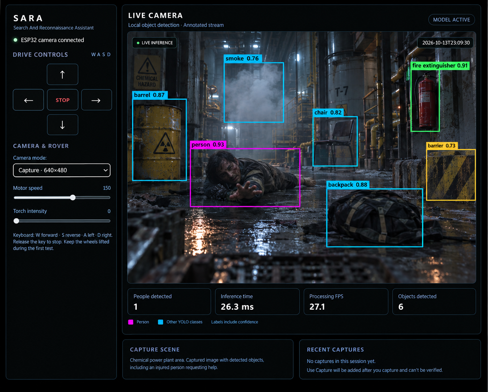

# SARA: Search And Rescue Agent

<p align="center">
  
</p>

## Overview
SARA (Search And Rescue Agent) is an ESP32-based reconnaissance rover that enables remote movement and live camera streaming in hazardous or hard-to-access environments, while a connected computer uses Python, OpenCV, and YOLOv8 to detect and annotate objects in real time through a web dashboard.

## Achievement
SARA was selected as a finalist in Hack the Hardware 2.0.

The project was recognized for its approach to combining an ESP32-based rover, real-time computer vision, and remote reconnaissance capabilities.

## Technology Stack

### Hardware

| Component | Purpose |
|---|---|
| ESP32-CAM  | Captures and streams live video |
| ESP32 microcontroller | Handles rover control and communication |
| DC motors and L298N motor driver | Provide rover movement |
| Rover chassis and wheels | Mobile platform |
| Laptop/PC | Runs the Python backend and control rover |

### Languages

| Language | Usage |
|---|---|
| Python | Backend server, video processing, object detection |
| C++ (Arduino) | ESP32 firmware and hardware control |
| HTML | Dashboard structure |
| CSS | Dashboard styling |
| JavaScript | Dashboard interactions and WebSocket communication |

### Libraries and Frameworks

| Library / Framework | Purpose |
|---|---|
| FastAPI | Python web server and API endpoints |
| Uvicorn | Runs the FastAPI application |
| WebSockets | Bidirectional communication between the browser, backend, and rover |
| Ultralytics YOLOv8n | Real-time object detection |
| OpenCV | Image processing and drawing detection annotations |
| NumPy | Numerical and image-array operations |
| Arduino ESP32 core | Firmware development and ESP32 hardware interfaces |
| ESPAsyncWebServer / AsyncTCP | Asynchronous web and WebSocket communication on the ESP32, if used by the firmware |

### Development Tools

- Visual Studio Code
- Arduino IDE or Arduino-compatible build environment
- Python and pip
- Git and GitHub
- Web browser for accessing the dashboard

## System Architecture

The system is divided into three main parts: the rover firmware, the Python vision backend, and the browser dashboard.

| Component | Connects to | Connection / Interface | Responsibility |
|---|---|---|---|
| ESP32 camera | Python backend | Wi-Fi access point and WebSocket | Streams JPEG camera frames |
| ESP32 firmware | Rover motors and light | GPIO and PWM | Executes movement, speed, and light commands |
| Python backend | ESP32 camera | WebSocket `/Camera` | Receives camera frames |
| Python backend | YOLOv8n | Local model inference | Detects supported object classes |
| Python backend | Browser dashboard | HTTP and WebSockets | Sends annotated frames and status information |
| Browser dashboard | Python backend | `/ws/video`, `/ws/control`, and HTTP API | Displays video and sends operator commands |
| Laptop / PC | ESP32 access point | Wi-Fi | Hosts the backend and processes video |


## Hardware Connections 

### ESP32 to L298N Pin Connections

| ESP32 Pin | L298N Pin | Function |
|---|---|---|
| GPIO 13 | IN1 | Right motor direction control |
| GPIO 15 | IN2 | Right motor direction control |
| GPIO 14 | IN3 | Left motor direction control |
| GPIO 2 | IN4 | Left motor direction control |
| GPIO 12 | ENA and ENB | Motor speed control (PWM) |

### L298N to Motors and Power

| L298N Connection | Connects To |
|---|---|
| OUT1 and OUT2 | Right DC motor terminals |
| OUT3 and OUT4 | Left DC motor terminals |
| Motor supply (`Vs` / `+12V`) | External motor power supply suitable for the motors |
| GND | Power supply negative and ESP32 GND |
| 5V  |Power supply positive and ESP32 5V|

\* **Note:** The firmware uses GPIO 12 for motor PWM. If the L298N module has separate ENA and ENB inputs, connect them in a way compatible with the firmware. If both enable inputs are tied together, both motors share the same speed command.

### Wiring Notes

- Connect the ESP32 and L298N grounds together.
- Power the motors from a suitable external supply, not directly from ESP32 GPIO pins.
- Check the L298N enable jumpers and module wiring before applying power.
- GPIO 2 and GPIO 12 are strapping pins on common ESP32 variants; verify boot behavior with the motor driver connected.
- Lift the rover's wheels during initial direction and speed tests.

### Data Flow

1. The ESP32 captures camera frames and transmits them over Wi-Fi.
2. The Python backend receives the frames and processes them using OpenCV.
3. YOLOv8n performs object detection on the incoming frames.
4. The backend annotates detected objects with bounding boxes, class names, and confidence scores.
5. The annotated video is streamed to the dashboard.
6. The operator uses the dashboard to send movement, motor speed, camera mode, and light commands.
7. The backend forwards the control commands to the ESP32 firmware.

## Project Structure

```text
SARA/
├── Backend/
│   ├── static/
│   │   └── index.html       
│   └── app.py               
├── firmware/
│   └── SARA_ESP32.ino       
├── models/
│   └── yolov8n.pt           
├── .gitignore               
├── README.md                
├── requirements.txt         
└── title.png                
```
The structure above represents the current project layout. The model file and generated captures are local runtime assets and do not need to be committed to GitHub.


## Setup ESP32 Firmware (`.ino`) Works
### 1. Install arduino IDE
### 2. Install the required Arduino libraries: `ESP Async WebServer` and `AsyncTCP` (via Library Manager)
### 3. Setup esp32CAM-AI board
### 4. copy and past the code inside SARA_ESP32.ino

**Note:** the firmware creates a Wi-Fi access point with default credentials in `SARA_ESP32.ino`. Change them before any public demonstration.


## How the Python Application (`app.py`) Works

The Python backend connects the hardware, computer-vision pipeline, and browser interface.

### 1. Backend Server

FastAPI exposes the HTTP endpoints and WebSocket routes used by the dashboard. Uvicorn runs the application.

### 2. Camera Frame Reception

The backend connects to the ESP32 camera endpoint:

`ws://192.168.4.1/Camera`

It receives the JPEG frames and prepares them for processing.

The address assumes the ESP32 is operating at `192.168.4.1` on its configured access point.

### 3. Object Detection

Ultralytics YOLOv8n processes the incoming frames and returns detections for classes supported by its pretrained dataset.

Each detection can include:

- Class name
- Bounding-box coordinates
- Confidence score

OpenCV is used to annotate frames for display.


### 4. Dashboard Video Streaming

The backend publishes annotated frames to the dashboard through `/ws/video`. The browser displays the stream alongside inference statistics.

### 5. Control Forwarding

The dashboard sends operator commands through `/ws/control`. The backend forwards the corresponding messages to the ESP32 control WebSocket endpoint.

This lets the operator control the rover without the browser communicating directly with the camera stream.

### 6. Status and Scene Capture

The application provides status information through `/api/status` and a capture operation through `/api/capture`.

The capture workflow is intended to preserve the original image, annotated image, timestamp, and detection information for later inspection.

## Setup and Execution

### Requirements

- Python 3.10 or newer installed on the computer (`app.py` uses `X | Y` type-hint syntax, which needs 3.10+)
- ESP32 rover with working firmware
- Camera and motor power supply
- Wi-Fi connection to the ESP32 access point
- Git, if cloning this repository

### 1. Clone the Repository

### 2. Create a Virtual Environment

```bash
python -m venv .venv
```

Activate it on Windows:

```powershell
.venv\Scripts\Activate.ps1
```

Or, in Command Prompt:

```bat
.venv\Scripts\activate.bat
```

### 3. Install Dependencies

```bash
python -m pip install -r requirements.txt
```

### 4. Obtain the YOLO Model

On first launch the backend automatically downloads the official pretrained YOLOv8n weights (`yolov8n.pt`) into the folder you start it from, so this step is optional when you have internet access.

For offline use, place a `yolov8n.pt` file in the folder you will start the backend from (the working directory), since `MODEL_PATH` in `app.py` is resolved relative to it. The `models/` folder is a local cache for the weights and is ignored by git.

### 5. Start the Backend

From the project root, run:

```bash
python -m uvicorn Backend.app:app --host 0.0.0.0 --port 8000
```

This command assumes that `Backend/app.py` exposes a FastAPI instance named `app`.

### 6. Connect to the Rover

1. Power on the ESP32 rover.
2. Connect the computer to the rover's Wi-Fi access point.
3. Confirm the ESP32 IP address and WebSocket endpoints.
4. Start the Python backend.
5. Open `http://127.0.0.1:8000` in a browser.
6. Verify the camera stream and controls before driving.

**Safety note:** Test movement with the wheels lifted initially. Use an appropriate power supply and stop the rover if communication or control becomes unreliable.


## Future Improvements

- Custom detection models for fire, smoke, and hazard-specific objects.
- Improved low-light vision and camera performance.
- Search-session logging and structured capture metadata.
- More robust communication-loss handling and emergency stop behavior.
- Further testing in controlled environments before real-world deployment.


